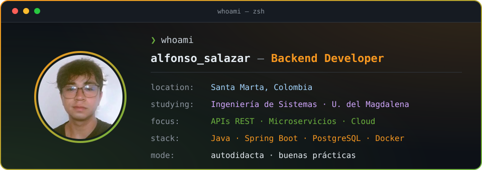
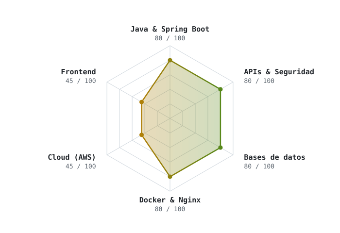

 

&nbsp;&nbsp;
&nbsp;&nbsp;

---

## `$ whoami`

  

Desarrollador backend especializado en el ecosistema de **Java**: construyo **APIs REST seguras** con **Spring Boot** y **Spring Security (JWT)**, y tengo experiencia con **Servlets** y **arquitectura de microservicios**. Contenerizo con **Docker** y **Docker Compose**, y persisto datos con **PostgreSQL**, **MySQL** y **JPA**.

He llevado un proyecto de principio a fin: desde el modelado del dominio y la API, hasta un frontend en React y el despliegue en la nube con **AWS** y **Vercel**. Soy autodidacta, orientado a las buenas prácticas y a crear soluciones eficientes, escalables y con bases sólidas de ingeniería.

> 💡 Conoce más sobre mí y mis proyectos en [mi portafolio](https://mi-portafolio-mu-one.vercel.app/).

---

## `$ cat stack.yml`

<table>
  <tr>
    <td width="50%" valign="top">
      <b>☕ Backend</b>  
       
      Java · Spring Boot · Spring Security · JWT · JPA / Hibernate · JDBC · Servlets · Maven
    </td>
    <td width="50%" valign="top">
      <b>🗄️ Bases de datos</b>  
       
      PostgreSQL · MySQL · Modelado relacional · Normalización
    </td>
  </tr>
  <tr>
    <td valign="top">
      <b>⚙️ DevOps y Cloud</b>  
       
      Docker · Docker Compose · Nginx · Linux · AWS (EC2 / RDS) · Vercel
    </td>
    <td valign="top">
      <b>🧩 Frontend</b>  
       
      HTML · CSS · JavaScript · jQuery · React (básico)
    </td>
  </tr>
  <tr>
    <td colspan="2" valign="top">
      <b>🛠️ Herramientas</b>  
       
      Git · GitHub · Swagger · Postman
    </td>
  </tr>
</table>

---

## `$ ./skills --radar`

  <picture>
    <source media="(prefers-color-scheme: dark)" srcset="assets/radar-dark.svg">
    <source media="(prefers-color-scheme: light)" srcset="assets/radar-light.svg">
    
  </picture>

<code>autoevaluación 0–100 · siempre aprendiendo</code>

---

## `$ ls ~/proyectos`

<table>
  <tr>
    <td width="38%" valign="middle">
      
    </td>
    <td valign="top">
      <h3>🏨 Verdant Hotel — Sistema de reservas hoteleras</h3>
      
Construido de principio a fin: modelado del dominio, API REST en <b>Java 21</b> y <b>Spring Boot</b> con autenticación <b>JWT</b> y roles, y reglas de negocio validadas en el servidor (reservas sin cruces de fechas, check-in / check-out e historial de estados). Frontend en React con calendario y panel de administración. Contenerizado con Docker Compose y Nginx, y desplegado en AWS (EC2 + RDS) y Vercel.

      
<code>Java 21</code> <code>Spring Boot</code> <code>Spring Security</code> <code>JWT</code> <code>PostgreSQL</code> <code>React</code> <code>Docker</code> <code>AWS</code> <code>Vercel</code>

      
🔗 <a href="https://proyecto-hotel-beta.vercel.app/">Demo</a> · ⚙️ <a href="https://github.com/AlfonsoMSDL/Proyecto-hotel-backend">Backend</a> · 🎨 <a href="https://github.com/AlfonsoMSDL/Proyecto-hotel">Frontend</a>

    </td>
  </tr>
  <tr>
    <td width="38%" valign="middle">
      
    </td>
    <td valign="top">
      <h3>🤝 VoluntariApp — Gestión de voluntariado</h3>
      
Sistema construido con microservicios en Java, Tomcat y PostgreSQL. Implementé cerca del 70 % del backend, la arquitectura con Docker Compose y el enrutamiento con Nginx. Permite a administradores, voluntarios y organizaciones gestionar proyectos, inscripciones y participaciones.

      
<code>Java</code> <code>Tomcat</code> <code>PostgreSQL</code> <code>Docker Compose</code> <code>Nginx</code> <code>Microservicios</code>

      
📦 <a href="https://github.com/AlfonsoMSDL/microservicios-voluntariApp">Repositorio</a>

    </td>
  </tr>
  <tr>
    <td width="38%" valign="middle">
      
    </td>
    <td valign="top">
      <h3>🎾 Base de datos Roland Garros</h3>
      
Base de datos relacional del torneo, desde las historias de usuario hasta el modelado conceptual y lógico y la normalización. Implementada por completo en PostgreSQL (tablas, datos, vistas y funciones) con consultas que responden 20 preguntas de negocio.

      
<code>PostgreSQL</code> <code>SQL</code> <code>Modelado relacional</code> <code>Normalización</code>

      
📦 <a href="https://github.com/AlfonsoMSDL/RolandGarrosBD">Repositorio</a>

    </td>
  </tr>
</table>

<b>📂 Más repositorios</b>

 

| Proyecto | Descripción | Tecnología |
|---|---|---|
| [Conversor de monedas](https://github.com/AlfonsoMSDL/Conversor-de-monedas) | Conversor de monedas que consume una API | `Java` |
| [Métodos de búsqueda en IA](https://github.com/AlfonsoMSDL/Metodos-de-busqueda-IA) | Implementación de métodos de búsqueda para la materia de IA | `Python` |
| [Trueque estudiantil (frontend)](https://github.com/AlfonsoMSDL/trueque-frontend-react) | Frontend del trueque estudiantil con React | `React` · `JavaScript` |

---

## `$ cat formacion.md`

| | Formación | Institución | Periodo |
|---|---|---|---|
| 🎓 | **Ingeniería de Sistemas** | Universidad del Magdalena | 2022 – actual |
| 📒 | **Técnico en contabilización de operaciones comerciales y financieras** | SENA | 2020 – 2021 |
| ☕ | **Variables y estructuras de control en la POO: Java** | SENA | Jul – Ago 2021 |

---

## `$ echo $SOFT_SKILLS`

<table>
  <tr>
    <td width="33%" valign="top">🌱 <b>Autodidacta</b> Me adapto rápidamente y aprendo nuevas tecnologías por iniciativa propia.</td>
    <td width="33%" valign="top">⚡ <b>Proactivo</b> Tomo acción, propongo soluciones y busco mejorar procesos continuamente.</td>
    <td width="33%" valign="top">✅ <b>Responsable</b> Cumplo con mis tareas de forma organizada y con enfoque en calidad.</td>
  </tr>
  <tr>
    <td valign="top">💬 <b>Comunicativo</b> Trabajo en equipo, explico ideas técnicas y colaboro de forma efectiva.</td>
    <td valign="top">🔍 <b>Orientado al detalle</b> Me aseguro de que cada componente esté bien diseñado y funcione correctamente.</td>
    <td valign="top">🧠 <b>Resolución de problemas</b> Disfruto analizar y encontrar soluciones limpias y eficientes.</td>
  </tr>
</table>

---

## `$ ./contacto.sh`

&nbsp;&nbsp;
&nbsp;&nbsp;

 
 

Hecho con ☕ desde Santa Marta, Colombia · <a href="https://github.com/AlfonsoMSDL">@AlfonsoMSDL</a>

